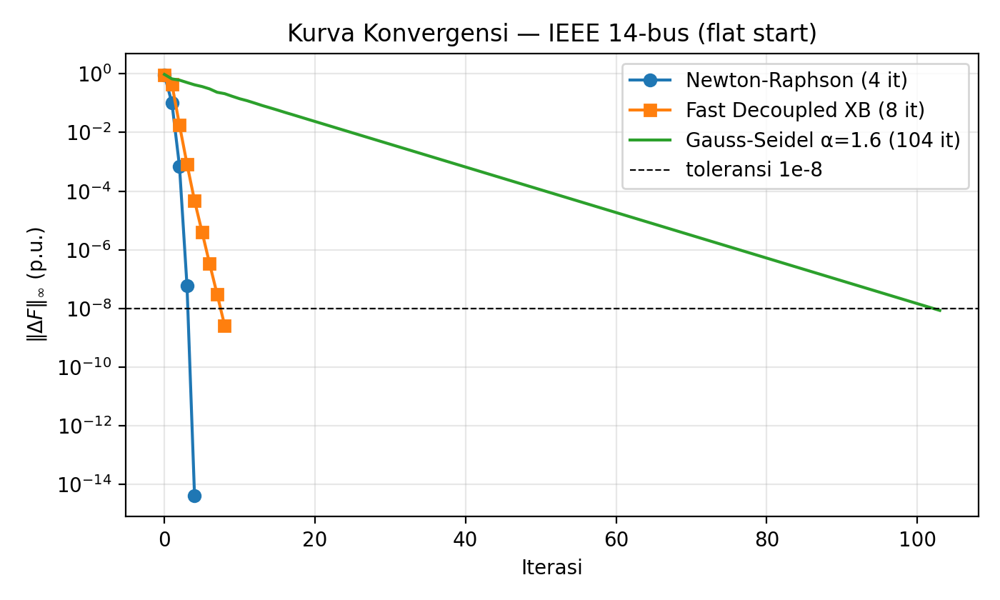
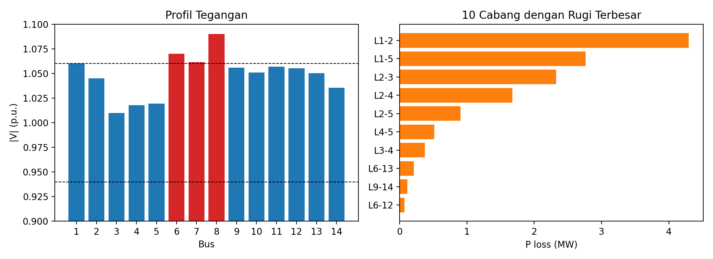
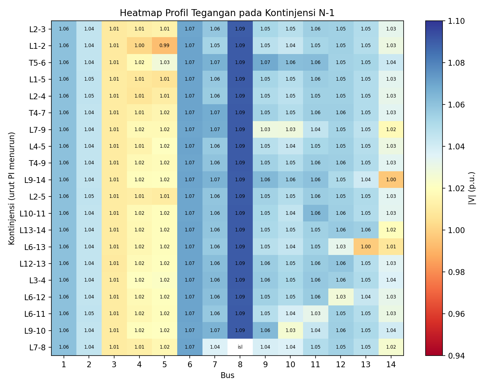
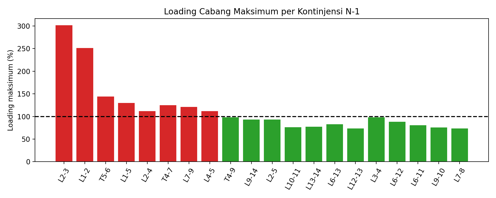
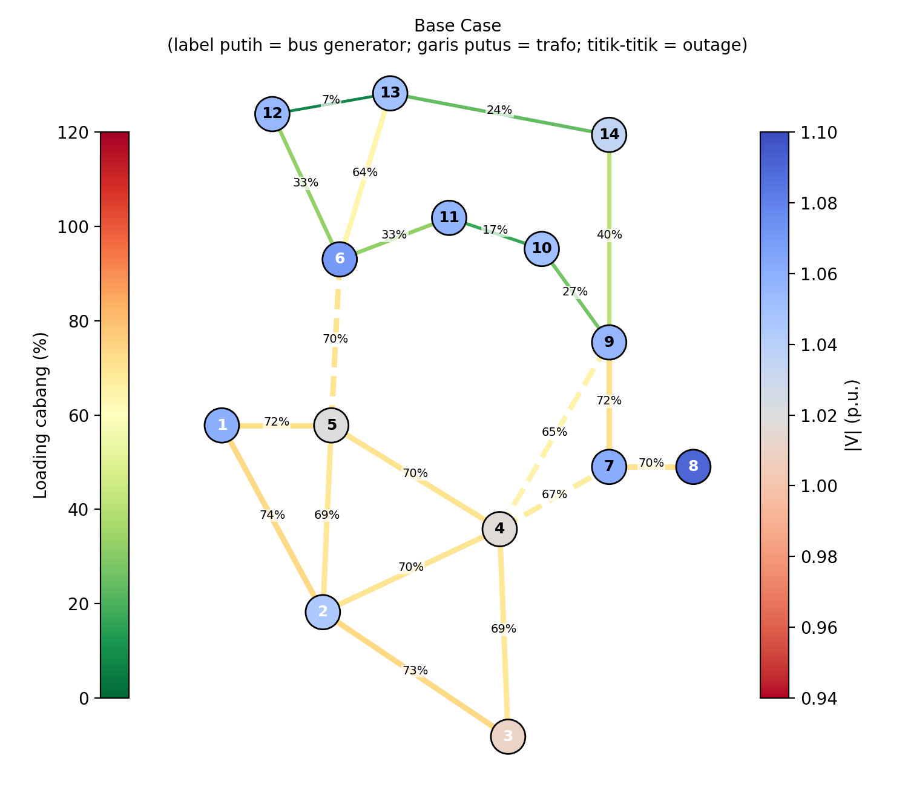
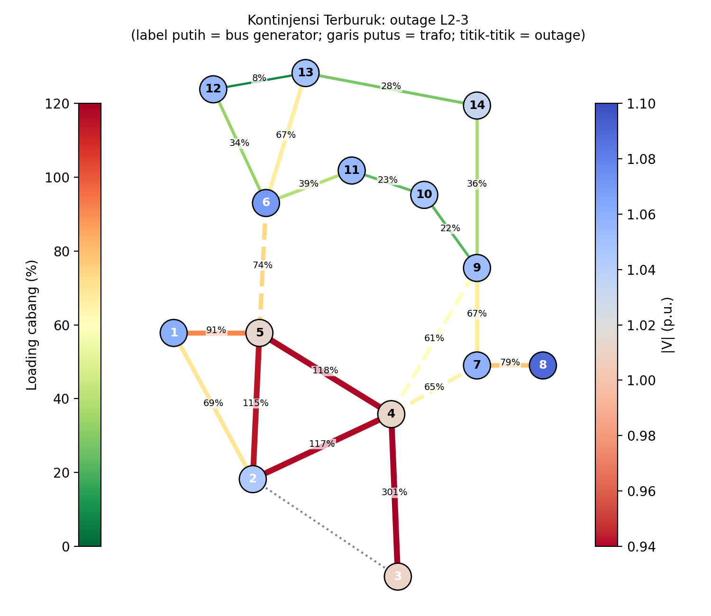

# Analisis Aliran Daya (Power Flow Analysis) Menggunakan Python
## Dari Algoritma Numerik hingga Aplikasi Industri

**Buku Panduan Pelatihan Teknis Intensif — Edisi Draf 1.0 (November 2026)**

---

## Daftar Isi

0. [Pendahuluan](#0-pendahuluan)
1. [Modul 1 — Pemodelan Jaringan & Pembentukan Matriks Admitansi Bus (Ybus)](#modul-1--pemodelan-jaringan--pembentukan-matriks-admitansi-bus-ybus)
2. [Modul 2 — Implementasi Algoritma Numerik From-Scratch](#modul-2--implementasi-algoritma-numerik-from-scratch)
3. [Modul 3 — Otomasi & Skala Industri Menggunakan pandapower](#modul-3--otomasi--skala-industri-menggunakan-pandapower)
4. [Modul 4 — Studi Kasus Nyata & Analisis Kontinjensi N-1](#modul-4--studi-kasus-nyata--analisis-kontinjensi-n-1)
5. [Proyek Capstone & Skema Penilaian Akhir](#5-proyek-capstone--skema-penilaian-akhir)
6. [Lampiran](#6-lampiran)

---

## 0. Pendahuluan

### 0.1 Kata Pengantar

Analisis aliran daya (*load flow / power flow*) adalah perhitungan yang paling sering dijalankan oleh seorang insinyur sistem tenaga. Hampir semua studi lanjutan — kontinjensi, *optimal power flow*, stabilitas, perencanaan ekspansi, hosting capacity energi terbarukan — selalu dimulai dari satu solusi aliran daya yang benar. Ironisnya, banyak praktisi hanya mengenal aliran daya sebagai "tombol *Run*" pada perangkat lunak komersial, tanpa memahami apa yang terjadi di dalamnya, kapan hasilnya boleh dipercaya, dan mengapa solver kadang gagal konvergen.

Pelatihan ini menjembatani dua dunia itu. Peserta **membangun solver dari nol** (Ybus, Newton-Raphson, Jacobian, Q-limit, FDLF, Gauss-Seidel) supaya memahami mekanismenya, lalu **beralih ke pustaka kelas industri (pandapower)** untuk mengotomasi studi berskala besar, misalnya analisis kontinjensi N-1. Setiap hasil solver buatan sendiri **divalidasi silang** terhadap pandapower sampai selisihnya di bawah 10⁻⁹ p.u.

### 0.2 Profil & Prasyarat Peserta

| Aspek | Prasyarat minimum |
|---|---|
| Rangkaian listrik | Fasor, daya kompleks $S = P + jQ$, analisis nodal, sistem per-unit |
| Sistem tenaga | Konsep bus, saluran transmisi, transformator (tingkat pengantar) |
| Matematika | Aljabar linear (matriks, invers, SPL), turunan parsial, deret Taylor |
| Python | Fungsi, *loop*, *list/dict*, dasar NumPy (array, *indexing*) |

### 0.3 Capaian Pembelajaran Umum

Setelah pelatihan, peserta mampu:

1. **Memodelkan** jaringan transmisi (saluran nominal-π, trafo bertap/phase-shifter, shunt) ke dalam matriks Ybus *sparse*.
2. **Mengimplementasikan dan men-debug** solver Newton-Raphson polar lengkap dengan penanganan batas daya reaktif.
3. **Membandingkan secara kritis** NR, FDLF, dan Gauss-Seidel dari sisi akurasi, kecepatan, dan robustnes.
4. **Mengotomasi** studi aliran daya dan kontinjensi N-1 menggunakan pandapower dan pandas.
5. **Mengomunikasikan** hasil studi melalui visualisasi teknis dan laporan yang dapat dipertanggungjawabkan.

Tujuan pembelajaran per modul diberi label tingkat kognitif Taksonomi Bloom revisi (**C1** Mengingat, **C2** Memahami, **C3** Menerapkan, **C4** Menganalisis, **C5** Mengevaluasi, **C6** Mencipta).

### 0.4 Format & Jadwal Pelatihan (4 hari × 8 jam = 32 jam)

| Hari | Sesi Pagi (08.30–12.00) | Sesi Siang (13.00–16.30) | Luaran |
|---|---|---|---|
| 1 | Modul 1: Teori pemodelan & per-unit | Lab 1: Membangun `make_ybus()` sparse | Fungsi Ybus tervalidasi |
| 2 | Modul 2: NR polar, Jacobian, Q-limit | Lab 2: Solver NR + FDLF + GS | Solver dan kurva konvergensi |
| 3 | Modul 3: Model data pandapower | Lab 3: IEEE 14/30-bus, profil V & rugi-rugi | Laporan aliran daya |
| 4 | Modul 4: Kriteria N-1 & indeks keparahan | Lab 4 + presentasi capstone | Dashboard kontinjensi |

Komposisi tiap sesi: ±30% ceramah interaktif, ±60% *hands-on* terbimbing, ±10% diskusi/kuis.

### 0.5 Lingkungan Perangkat Lunak

```bash
python -m venv .venv && source .venv/bin/activate      # Windows: .venv\Scripts\activate
pip install -r requirements.txt                          # numpy, scipy, pandas, matplotlib, pandapower
```

Struktur repositori pendamping:

```
powerflowtraining/
├── Buku_Panduan_Pelatihan_Power_Flow_Python.md   ← dokumen ini
├── requirements.txt
├── ybus.py                     # pustaka modular beranotasi tipe: Ybus sparse & data IEEE 5/14-bus
├── newton_raphson.py           # pustaka modular NR polar (eksplisit & sparse) + Q-limit back-switching
├── pandapower_workflow.py      # alur kerja industri pandapower, skrining N-1 cepat, & heatmap
├── kode/                       # skrip praktikum per modul & pembanding algoritma (FDLF, GS)
│   ├── ieee14_data.py          # data IEEE 14-bus format MATPOWER
│   ├── pf_core.py              # pustaka ringkas praktikum: Ybus, NR, Q-limit, FDLF, GS
│   ├── validasi_modul1_2.py    # skrip uji & validasi Modul 1–2
│   ├── modul3_pandapower.py    # konversi data & analisis pandapower
│   └── modul4_n1.py            # otomasi kontinjensi N-1 & diagram topologi
├── figures/                    # keluaran grafik
└── hasil/                      # keluaran tabel (CSV)
```

> **Catatan untuk instruktur:** `kode/` berisi **solusi referensi** yang sudah diuji. Untuk peserta, bagikan versi *skeleton* (bagian bertanda `# TODO`) yang dicontohkan pada setiap modul, lalu gunakan solusi referensi sebagai kunci dan *auto-grader*.

### 0.6 Konvensi Notasi

| Simbol | Arti |
|---|---|
| $N_b$, $N_l$ | jumlah bus, jumlah cabang |
| $V_i = \lvert V_i\rvert\angle\theta_i$ | tegangan fasor bus $i$ (p.u.) |
| $Y_{ik} = G_{ik} + jB_{ik}$ | elemen matriks admitansi bus |
| $\theta_{ik} = \theta_i - \theta_k$ | beda sudut antar-bus |
| $S_i = P_i + jQ_i$ | injeksi daya bersih ke bus $i$ (pembangkitan − beban) |
| $\mathcal{PV}, \mathcal{PQ}$ | himpunan indeks bus PV dan PQ |

Semua besaran dinyatakan dalam per-unit dengan $S_{base} = 100$ MVA, kecuali disebutkan lain.

---

## Modul 1 — Pemodelan Jaringan & Pembentukan Matriks Admitansi Bus (Ybus)

### 1(a) Tujuan Pembelajaran

Setelah menyelesaikan modul ini, peserta mampu:

| Kode | Tujuan | Level |
|---|---|---|
| TP1.1 | Menyebutkan tiga jenis bus (Slack, PV, PQ) beserta besaran yang diketahui dan dicari | C1 |
| TP1.2 | Menjelaskan model nominal-π saluran dan model trafo *off-nominal tap*/phase-shifter | C2 |
| TP1.3 | Mengonversi data peralatan ke sistem per-unit dan membentuk Ybus secara manual untuk sistem 3-bus | C3 |
| TP1.4 | Mengimplementasikan fungsi Ybus *sparse* tervektorisasi dengan NumPy/SciPy | C3 |
| TP1.5 | Menganalisis sifat Ybus (sparsity, simetri, dominansi diagonal) dan dampak trafo phase-shifter | C4 |
| TP1.6 | Mengevaluasi kebenaran Ybus buatan sendiri terhadap pustaka referensi | C5 |

### 1(b) Ringkasan Teori & Persamaan Utama

#### 1.1 Sistem per-unit

$$
Z_{base} = \frac{V_{base,LL}^2}{S_{base}},\qquad
z_{pu} = \frac{Z_{\Omega}}{Z_{base}},\qquad
z_{pu}^{baru} = z_{pu}^{lama}\left(\frac{V_{base}^{lama}}{V_{base}^{baru}}\right)^2\frac{S_{base}^{baru}}{S_{base}^{lama}}
$$

Sistem per-unit menormalkan perbedaan level tegangan sehingga trafo dengan rasio nominal "hilang" dari model. Yang tersisa hanyalah deviasi rasio (*off-nominal tap*).

#### 1.2 Klasifikasi bus dan pemodelan sumber/beban

| Jenis bus | Diketahui | Dicari | Peran fisik |
|---|---|---|---|
| **Slack/Referensi** | $\lvert V\rvert$, $\theta = 0$ | $P$, $Q$ | Menutup neraca daya dan rugi-rugi; referensi sudut |
| **PV (generator)** | $P$, $\lvert V\rvert$ | $Q$, $\theta$ | Generator dengan AVR; $Q_{min} \le Q \le Q_{max}$ |
| **PQ (beban)** | $P$, $Q$ | $\lvert V\rvert$, $\theta$ | Beban daya konstan, atau generator yang terkunci pada batas Q |

Injeksi bersih yang dijadwalkan: $S_i^{sch} = (P_{G,i} - P_{D,i}) + j(Q_{G,i} - Q_{D,i})$.
Beban pada dasarnya bergantung tegangan (model ZIP: $P = P_0[a_Z\lvert V\rvert^2 + a_I\lvert V\rvert + a_P]$). Pada pelatihan ini dipakai model daya konstan ($a_P = 1$), sedangkan model ZIP menjadi topik pengayaan.

#### 1.3 Saluran transmisi — model nominal-π

Untuk saluran menengah (≈80–250 km), impedansi seri dan suseptansi *charging* total dipusatkan:

$$
y_s = \frac{1}{R + jX}, \qquad \text{shunt di tiap ujung} = j\frac{B}{2}
$$

#### 1.4 Transformator bertap dan phase-shifter

Trafo dimodelkan sebagai trafo ideal dengan rasio kompleks $a = t\,e^{j\varphi}$ di sisi *from*, diseri dengan admitansi bocor $y_s$. Model umum **cabang** (saluran sebagai kasus khusus $t = 1$, $\varphi = 0$) adalah:

$$
\begin{bmatrix} I_f \\ I_t \end{bmatrix} =
\underbrace{\begin{bmatrix}
\dfrac{y_s + j\frac{B}{2}}{t^2} & -\dfrac{y_s}{a^{*}} \\[2mm]
-\dfrac{y_s}{a} & y_s + j\frac{B}{2}
\end{bmatrix}}_{\displaystyle \begin{bmatrix} Y_{ff} & Y_{ft}\\ Y_{tf} & Y_{tt}\end{bmatrix}}
\begin{bmatrix} V_f \\ V_t \end{bmatrix}
$$

Untuk tap riil ($\varphi = 0$), persamaan di atas setara dengan rangkaian π: admitansi seri $y_s/t$, shunt sisi *from* $y_s(1-t)/t^2$, dan shunt sisi *to* $y_s(t-1)/t$. Bila $\varphi \neq 0$, berlaku $Y_{ft} \neq Y_{tf}$, sehingga **Ybus menjadi tidak simetris**. Ini perlu diingat ketika memilih solver linear.

#### 1.5 Perakitan Ybus — formulasi matriks insidensi

Definisikan matriks insidensi $C_f, C_t \in \{0,1\}^{N_l \times N_b}$ ($C_f[l, f_l] = 1$, $C_t[l, t_l] = 1$):

$$
Y_f = \operatorname{diag}(Y_{ff})\,C_f + \operatorname{diag}(Y_{ft})\,C_t,\qquad
Y_t = \operatorname{diag}(Y_{tf})\,C_f + \operatorname{diag}(Y_{tt})\,C_t
$$

$$
\boxed{\,Y_{bus} = C_f^{\mathsf T} Y_f + C_t^{\mathsf T} Y_t + \operatorname{diag}(Y_{sh})\,},\qquad
Y_{sh,i} = \frac{G_{S,i} + jB_{S,i}}{S_{base}}
$$

Interpretasi aturan inspeksi: $Y_{ii}$ = jumlah semua admitansi yang terhubung ke bus $i$, dan $Y_{ik}$ = negatif admitansi antara $i$ dan $k$ (dengan koreksi tap). Matriks $Y_f$ dan $Y_t$ dipakai kembali untuk menghitung arus serta aliran daya cabang: $S_f = V_f \odot (Y_f V)^{*}$.

#### 1.6 Sifat penting Ybus

- **Sparse**: tiap bus rata-rata hanya terhubung ke 2–4 bus lain. IEEE 14-bus memiliki densitas 27,6%, sedangkan jaringan 10.000 bus memiliki densitas < 0,05%. Karena itu wajib memakai format `scipy.sparse` (CSR/CSC).
- **Simetris** bila tidak ada phase-shifter.
- **Singular** bila tidak ada elemen shunt ke tanah. Inilah alasan solver tidak memakai $Z_{bus} = Y_{bus}^{-1}$ secara langsung.

### 1(c) Rencana Tugas Lab / Hands-on

**Durasi:** 3,5 jam  **Data:** IEEE 14-bus ([ieee14_data.py](kode/ieee14_data.py))

| Lab | Aktivitas | Waktu | Luaran |
|---|---|---|---|
| 1.1 Pemanasan (C3) | Hitung Ybus sistem 3-bus **dengan tangan**, lalu cocokkan dengan kode | 30 mnt | Lembar hitung |
| 1.2 Inti (C3) | Lengkapi *skeleton* `make_ybus()` tervektorisasi berbasis `scipy.sparse` | 75 mnt | Fungsi lulus uji |
| 1.3 Analisis (C4) | Visualisasikan pola sparsity (`plt.spy`), cek simetri, lalu tambahkan phase-shifter 5° pada cabang 4–7 dan amati efeknya | 45 mnt | Grafik + 1 paragraf analisis |
| 1.4 Validasi (C5) | Bandingkan dengan `pandapower` (`net._ppc["internal"]["Ybus"]`) atau `pypower.makeYbus` | 30 mnt | Laporan selisih maksimum |
| 1.5 Tantangan (C6) | Rancang fungsi `update_ybus_outage(Ybus, k)` yang memperbarui Ybus untuk outage cabang $k$ **tanpa** merakit ulang (*rank-1/rank-2 update*). Fungsi ini dipakai lagi di Modul 4 | opsional | Fungsi + uji kecepatan |

**Skeleton peserta (Lab 1.2):**

```python
import numpy as np
import scipy.sparse as sp

def make_ybus(baseMVA, bus, branch):
    nb, nl = bus.shape[0], branch.shape[0]
    stat = branch[:, 10]
    ys  = # TODO: admitansi seri, kalikan status cabang
    bc  = # TODO: suseptansi charging total
    tap = # TODO: tap=1 bila kolom TAP bernilai 0; kalikan exp(j*shift) (derajat -> radian)

    Ytt = ys + 1j * bc / 2
    Yff = # TODO
    Yft = # TODO
    Ytf = # TODO
    Ysh = # TODO: (GS + jBS)/baseMVA

    f = branch[:, 0].astype(int) - 1; t = branch[:, 1].astype(int) - 1
    Cf = sp.csr_matrix((np.ones(nl), (np.arange(nl), f)), shape=(nl, nb))
    Ct = # TODO
    Yf = # TODO: gunakan konstruktor COO -> CSR
    Yt = # TODO
    return (Cf.T @ Yf + Ct.T @ Yt + sp.diags(Ysh)).tocsr(), Yf, Yt
```

**Titik periksa (nilai kunci IEEE 14-bus):**

| Besaran | Nilai referensi |
|---|---|
| Ukuran / nnz Ybus | 14 × 14 / 54 elemen tak-nol (densitas 27,6%) |
| $Y_{11}$ | $6{,}025 - j19{,}447$ p.u. |
| Simetris (tanpa phase-shifter) | `True` |

Solusi referensi: [`make_ybus()`](kode/pf_core.py). Jalankan `python kode/validasi_modul1_2.py`.

### 1(d) Rubrik Evaluasi Praktikum Modul 1 (bobot 15% dari nilai akhir)

| Kriteria | Bobot | Sangat Baik (4) | Baik (3) | Cukup (2) | Kurang (1) |
|---|---|---|---|---|---|
| Ketepatan perhitungan manual 3-bus | 15% | Semua elemen benar, langkah runtut | 1 kesalahan minor | Konsep benar, ≥2 kesalahan hitung | Konsep keliru |
| Kebenaran `make_ybus()` | 35% | Lulus semua uji (saluran, tap, shift, shunt, cabang off) dengan galat < 1e-10 | Lulus kecuali kasus phase-shift | Hanya saluran tanpa tap | Tidak berjalan atau salah |
| Efisiensi & gaya kode | 20% | Tervektorisasi penuh, sparse, docstring dan nama variabel jelas | Sparse tetapi masih ada *loop* Python | Matriks *dense* | Kode sulit dibaca |
| Analisis sifat Ybus (Lab 1.3) | 20% | Menjelaskan sparsity, simetri, dan efek phase-shifter secara kuantitatif | Penjelasan benar tetapi kualitatif | Hanya grafik tanpa interpretasi | Tidak dikerjakan |
| Validasi silang (Lab 1.4) | 10% | Selisih dilaporkan beserta penjelasan sumber perbedaan konvensi | Selisih dilaporkan | Validasi parsial | Tidak ada |

---

## Modul 2 — Implementasi Algoritma Numerik From-Scratch

### 2(a) Tujuan Pembelajaran

| Kode | Tujuan | Level |
|---|---|---|
| TP2.1 | Menuliskan persamaan aliran daya bentuk polar dan definisi vektor mismatch | C1 |
| TP2.2 | Menjelaskan prinsip linearisasi Newton-Raphson dan arti konvergensi kuadratik | C2 |
| TP2.3 | Menurunkan dan mengimplementasikan Jacobian polar lengkap (H, N, M, L) | C3 |
| TP2.4 | Mengimplementasikan logika Q-limit switching PV → PQ | C3 |
| TP2.5 | Menganalisis perilaku konvergensi NR, FDLF, dan GS pada berbagai kondisi pembebanan | C4 |
| TP2.6 | Mengevaluasi pilihan solver yang tepat untuk suatu kasus (kecepatan vs robustnes vs rasio R/X) | C5 |
| TP2.7 | Merancang modifikasi solver (mis. *back-switching* PQ → PV atau *step-size control*) | C6 |

### 2(b) Ringkasan Teori & Persamaan Utama

#### 2.1 Persamaan aliran daya (bentuk polar)

Dari $S_i = V_i I_i^{*} = V_i \left(\sum_k Y_{ik} V_k\right)^{*}$ diperoleh:

$$
P_i(\boldsymbol\theta, \lvert\mathbf V\rvert) = \lvert V_i\rvert \sum_{k=1}^{N_b} \lvert V_k\rvert \left(G_{ik}\cos\theta_{ik} + B_{ik}\sin\theta_{ik}\right)
$$

$$
Q_i(\boldsymbol\theta, \lvert\mathbf V\rvert) = \lvert V_i\rvert \sum_{k=1}^{N_b} \lvert V_k\rvert \left(G_{ik}\sin\theta_{ik} - B_{ik}\cos\theta_{ik}\right)
$$

Dalam bentuk vektor yang ringkas untuk implementasi: $\mathbf S(\mathbf V) = \operatorname{diag}(\mathbf V)\,(Y_{bus}\mathbf V)^{*}$.

#### 2.2 Vektor mismatch dan variabel keadaan

$$
\mathbf F(\mathbf x) =
\begin{bmatrix} \Delta\mathbf P_{\mathcal{PV}\cup\mathcal{PQ}} \\ \Delta\mathbf Q_{\mathcal{PQ}} \end{bmatrix}
= \begin{bmatrix} \mathbf P^{calc} - \mathbf P^{sch} \\ \mathbf Q^{calc} - \mathbf Q^{sch} \end{bmatrix},
\qquad
\mathbf x = \begin{bmatrix} \boldsymbol\theta_{\mathcal{PV}\cup\mathcal{PQ}} \\ \lvert\mathbf V\rvert_{\mathcal{PQ}} \end{bmatrix}
$$

Dimensi sistem: $n = (N_{PV} + N_{PQ}) + N_{PQ}$. Untuk IEEE 14-bus (4 PV, 9 PQ), $n = 13 + 9 = 22$.

#### 2.3 Iterasi Newton-Raphson

$$
\mathbf J(\mathbf x^{(\nu)})\,\Delta\mathbf x^{(\nu)} = -\mathbf F(\mathbf x^{(\nu)}),\qquad
\mathbf x^{(\nu+1)} = \mathbf x^{(\nu)} + \Delta\mathbf x^{(\nu)}
$$

> **Catatan dua konvensi tanda mismatch.** Literatur dan perangkat lunak aliran daya terbagi atas dua konvensi yang **ekuivalen secara matematis**:
> 1. $\mathbf F = \mathbf S^{calc} - \mathbf S^{sch}$ sehingga $\mathbf J\,\Delta\mathbf x = -\mathbf F$ (dipakai pada persamaan buku ini dan `kode/pf_core.py`).
> 2. $\Delta\mathbf S = \mathbf S^{sch} - \mathbf S^{calc}$ sehingga $\mathbf J\,\Delta\mathbf x = +\Delta\mathbf S$ (dipakai pada `newton_raphson.py` dan buku Grainger & Stevenson).
> Pastikan tanda ruas kanan pada solver linear selalu berpasangan tepat dengan definisi mismatch yang dipilih.

Kriteria berhenti: $\lVert\mathbf F\rVert_\infty < \varepsilon$ (umumnya $10^{-6}$–$10^{-8}$ p.u.). Di dekat solusi, NR **konvergen kuadratik**: jumlah digit benar kira-kira berlipat dua setiap iterasi. Gejala ini terlihat jelas pada kurva konvergensi (Gambar 2.1).

#### 2.4 Matriks Jacobian polar lengkap

$$
\mathbf J = \begin{bmatrix} \mathbf H & \mathbf N \\ \mathbf M & \mathbf L \end{bmatrix}
= \begin{bmatrix}
\partial\mathbf P / \partial\boldsymbol\theta & \partial\mathbf P / \partial\lvert\mathbf V\rvert \\
\partial\mathbf Q / \partial\boldsymbol\theta & \partial\mathbf Q / \partial\lvert\mathbf V\rvert
\end{bmatrix}
$$

| Sub-matriks | Off-diagonal ($i \neq k$) | Diagonal ($i = k$) |
|---|---|---|
| $H_{ik} = \partial P_i/\partial\theta_k$ | $\lvert V_i\rvert\lvert V_k\rvert(G_{ik}\sin\theta_{ik} - B_{ik}\cos\theta_{ik})$ | $-Q_i - B_{ii}\lvert V_i\rvert^2$ |
| $N_{ik} = \partial P_i/\partial\lvert V_k\rvert$ | $\lvert V_i\rvert(G_{ik}\cos\theta_{ik} + B_{ik}\sin\theta_{ik})$ | $P_i/\lvert V_i\rvert + G_{ii}\lvert V_i\rvert$ |
| $M_{ik} = \partial Q_i/\partial\theta_k$ | $-\lvert V_i\rvert\lvert V_k\rvert(G_{ik}\cos\theta_{ik} + B_{ik}\sin\theta_{ik})$ | $P_i - G_{ii}\lvert V_i\rvert^2$ |
| $L_{ik} = \partial Q_i/\partial\lvert V_k\rvert$ | $\lvert V_i\rvert(G_{ik}\sin\theta_{ik} - B_{ik}\cos\theta_{ik})$ | $Q_i/\lvert V_i\rvert - B_{ii}\lvert V_i\rvert$ |

**Bentuk matriks tervektorisasi** (lebih cepat dan bebas *loop*), dengan $\mathbf I = Y_{bus}\mathbf V$ dan $\bar{\mathbf V} = \mathbf V/\lvert\mathbf V\rvert$:

$$
\frac{\partial\mathbf S}{\partial\lvert\mathbf V\rvert} = \operatorname{diag}(\mathbf V)\left(Y_{bus}\operatorname{diag}(\bar{\mathbf V})\right)^{*} + \operatorname{diag}(\mathbf I)^{*}\operatorname{diag}(\bar{\mathbf V}),
\qquad
\frac{\partial\mathbf S}{\partial\boldsymbol\theta} = j\operatorname{diag}(\mathbf V)\left(\operatorname{diag}(\mathbf I) - Y_{bus}\operatorname{diag}(\mathbf V)\right)^{*}
$$

Bagian riil memberi $\mathbf H, \mathbf N$, sedangkan bagian imajiner memberi $\mathbf M, \mathbf L$. Pada lab, peserta membuktikan secara numerik bahwa kedua bentuk identik (galat ≈ 10⁻¹⁴).

> **Catatan konvensi.** Sebagian buku teks memakai $\partial P/\partial\lvert V\rvert \cdot \lvert V\rvert$ (Jacobian "termodifikasi") agar H–L dan N–M memiliki struktur serupa. Hasil akhirnya identik; yang penting variabel koreksi $\Delta\lvert V\rvert$ atau $\Delta\lvert V\rvert/\lvert V\rvert$ diperbarui secara konsisten.

#### 2.5 Penanganan batas daya reaktif generator (Q-limit switching)

Generator hanya dapat menahan tegangan selama kapabilitas reaktifnya mencukupi. Algoritma *outer loop*:

```
1. Selesaikan NR dengan semua generator sebagai bus PV.
2. Hitung Q_G,i = Q_i^calc + Q_D,i untuk setiap bus PV.
3. Jika Q_G,i > Q_max,i  → set Q_G,i = Q_max,i dan ubah bus i menjadi PQ.
   Jika Q_G,i < Q_min,i  → set Q_G,i = Q_min,i dan ubah bus i menjadi PQ.
4. Jika ada perubahan tipe bus → ulangi dari langkah 1 (hot start dari solusi terakhir).
5. (Lanjutan) Back-switching: bus PQ hasil konversi dikembalikan ke PV bila
   |V_i| bergerak ke arah yang membuat Q kembali di dalam batas
   (Q di Q_max namun |V_i| > V_set, atau Q di Q_min namun |V_i| < V_set).
```

Bus yang dikonversi kehilangan kendali tegangan, sehingga $\lvert V_i\rvert$ menyimpang dari *setpoint*. Konsekuensi ini dianalisis dalam Lab 2.4.

#### 2.6 Fast Decoupled Load Flow (FDLF)

Asumsi sistem transmisi: $X \gg R$, $\theta_{ik}$ kecil, dan $\lvert V\rvert \approx 1$. Akibatnya $\mathbf N \approx 0$ dan $\mathbf M \approx 0$, dan karena $H_{ii} \approx -B_{ii}\lvert V_i\rvert^2 = +B'_{ii}\lvert V_i\rvert^2$ (dengan $\mathbf B', \mathbf B''$ berdiagonal positif), persamaan koreksi $\mathbf J\,\Delta\mathbf x = -\mathbf F$ terdekopel menjadi dua sistem dengan **matriks konstan**:

$$
-\frac{\Delta\mathbf P}{\lvert\mathbf V\rvert} = \mathbf B'\,\Delta\boldsymbol\theta,\qquad
-\frac{\Delta\mathbf Q}{\lvert\mathbf V\rvert} = \mathbf B''\,\Delta\lvert\mathbf V\rvert
$$
*(dengan $\Delta\mathbf P = \mathbf P^{calc} - \mathbf P^{sch}$ dan $\Delta\mathbf Q = \mathbf Q^{calc} - \mathbf Q^{sch}$; tanda negatif hilang apabila mismatch didefinisikan sebagai $\mathbf S^{sch} - \mathbf S^{calc}$).*

- **Skema XB**: $\mathbf B'$ dibentuk dari $1/x$ saja (tanpa R, shunt, dan tap), sedangkan $\mathbf B''$ diambil dari $-\operatorname{Im}(Y_{bus})$ tanpa phase-shift. Skema **BX** adalah kebalikannya.
- $\mathbf B'$ dan $\mathbf B''$ difaktorisasi **satu kali** (LU), lalu setiap iterasi hanya melakukan substitusi maju-mundur. Iterasi lebih banyak, tetapi setiap iterasi jauh lebih murah.
- Kelemahan: konvergensi memburuk pada jaringan dengan rasio R/X tinggi, misalnya jaringan distribusi.

#### 2.7 Gauss-Seidel (GS)

$$
V_i^{(\nu+1)} = \frac{1}{Y_{ii}}\left[\frac{P_i^{sch} - jQ_i^{sch}}{V_i^{(\nu)*}} - \sum_{k<i} Y_{ik}V_k^{(\nu+1)} - \sum_{k>i} Y_{ik}V_k^{(\nu)}\right]
$$

Untuk bus PV, hitung dahulu $Q_i = -\operatorname{Im}\{V_i^{*}\sum_k Y_{ik}V_k\}$, lalu setelah pembaruan normalisasikan $\lvert V_i\rvert$ ke *setpoint*. Faktor akselerasi: $V_i \leftarrow V_i^{(\nu)} + \alpha(V_i^{new} - V_i^{(\nu)})$ dengan $\alpha \approx 1{,}4$–$1{,}6$.

#### 2.8 Perbandingan algoritma (hasil aktual IEEE 14-bus, flat start, ε = 10⁻⁸)

| Metode | Iterasi | Konvergensi | Biaya per iterasi | Kegunaan utama |
|---|---|---|---|---|
| Newton-Raphson | **4** | Kuadratik | Tinggi (bentuk ulang dan faktorisasi J) | Standar industri, robust |
| FDLF (XB) | 8 | Linear (cepat) | Rendah (LU konstan) | Studi berulang, kontinjensi, *real-time* |
| Gauss-Seidel (α = 1,6) | 104 | Linear (lambat) | Sangat rendah | Pedagogi, inisialisasi |



### 2(c) Rencana Tugas Lab / Hands-on

**Durasi:** 3,5 jam + tugas rumah  **Pustaka referensi:** [pf_core.py](kode/pf_core.py)

| Lab | Aktivitas | Waktu | Luaran |
|---|---|---|---|
| 2.1 (C3) | Implementasi `mismatch()` dan Jacobian **per-elemen** (loop) dari tabel 2.4 | 45 mnt | Fungsi `jacobian_polar_explicit()` |
| 2.2 (C3–C4) | Implementasi Jacobian **tervektorisasi**. Buktikan kesamaan dengan 2.1 (galat < 1e-10) dan bandingkan waktu eksekusi | 30 mnt | Tabel waktu |
| 2.3 (C3) | Lengkapi `newton_raphson()`: cetak $\lVert F\rVert_\infty$ per iterasi dan verifikasi konvergensi kuadratik | 45 mnt | Log iterasi + plot semilog |
| 2.4 (C4) | **Q-limit:** turunkan $Q_{max}$ generator bus 8 menjadi 10 MVAr, jalankan `runpf_qlim()`, lalu jelaskan perubahan $\lvert V_8\rvert$ dan aliran daya reaktif | 30 mnt | Analisis 1 halaman |
| 2.5 (C4–C5) | Implementasi FDLF-XB dan GS. Bandingkan iterasi/waktu, lalu ulangi setelah **R semua saluran dikali 3** (simulasi R/X tinggi). Metode mana yang paling terdampak dan mengapa? | 60 mnt | Tabel + rekomendasi |
| 2.6 Tantangan (C6) | Tambahkan *back-switching* PQ → PV atau *line search* (Iwamoto multiplier) dan uji pada pembebanan 2,5× | rumah | Kode + laporan |

**Titik periksa (nilai kunci):**

| Besaran | Nilai referensi |
|---|---|
| Ukuran Jacobian | 22 × 22 |
| Riwayat $\lVert F\rVert_\infty$ NR | 9,22e-1 → 1,01e-1 → 7,10e-4 → 5,98e-8 → 4,1e-15 |
| $\lvert V_{14}\rvert$, $\theta_{14}$ | 1,0355 p.u., −16,034° |
| Rugi total | 13,393 MW + j30,122 MVAr |
| Validasi vs pandapower | max Δ\|V\| ≈ 6e-12 p.u., max Δθ ≈ 4e-10° |
| Q-limit (Qmax₈ = 10 MVAr) | Bus 8 berpindah PV → PQ; \|V₈\| turun dari 1,090 ke **1,0675 p.u.**; konvergen dalam 2 *outer loop* |

### 2(d) Rubrik Evaluasi Praktikum Modul 2 (bobot 25%)

| Kriteria | Bobot | Sangat Baik (4) | Baik (3) | Cukup (2) | Kurang (1) |
|---|---|---|---|---|---|
| Jacobian (per-elemen dan vektor) | 25% | Keduanya benar, kesamaan dibuktikan numerik | Satu bentuk benar, bentuk lain ada galat kecil | Hanya sebagian sub-matriks benar | Salah atau tidak ada |
| Solver NR | 25% | Konvergen 4 iterasi, hasil cocok referensi < 1e-8, menangani divergensi (batas iterasi, pesan) | Konvergen, tanpa penanganan divergensi | Konvergen lambat (indikasi Jacobian salah) | Tidak konvergen |
| Q-limit switching | 20% | Benar, multi-generator, analisis fisik tajam; *back-switching* (bonus) | Benar dan analisis memadai | Switching benar tetapi Qg tidak dikunci tepat | Tidak berfungsi |
| FDLF & GS + studi R/X | 20% | Keduanya berjalan, perbandingan kuantitatif dan rekomendasi berbasis bukti | Berjalan, perbandingan kualitatif | Hanya satu metode | Tidak dikerjakan |
| Dokumentasi & visualisasi | 10% | Plot semilog berlabel lengkap, kode terdokumentasi | Plot ada, label kurang | Hanya angka | Tidak ada |

---

## Modul 3 — Otomasi & Skala Industri Menggunakan pandapower

### 3(a) Tujuan Pembelajaran

| Kode | Tujuan | Level |
|---|---|---|
| TP3.1 | Mengenali struktur data `pandapowerNet` (tabel elemen dan tabel `res_*`) | C1 |
| TP3.2 | Menjelaskan pemetaan parameter p.u. MATPOWER ke parameter fisik pandapower (Ω/km, nF/km, vk%) | C2 |
| TP3.3 | Mengonversi data IEEE 14-bus/30-bus ke pandapower dan menjalankan AC power flow | C3 |
| TP3.4 | Menganalisis profil tegangan dan distribusi rugi-rugi menggunakan operasi pandas | C4 |
| TP3.5 | Mengevaluasi kepatuhan hasil terhadap batas operasi (pita tegangan, Grid Code) | C5 |
| TP3.6 | Merancang skrip studi yang dapat dipakai ulang (parameterisasi skenario beban) | C6 |

### 3(b) Ringkasan Teori & Persamaan Utama

#### 3.1 Mengapa pustaka industri?

Solver buatan sendiri unggul untuk pemahaman, tetapi studi nyata membutuhkan: model peralatan lengkap (trafo 3-belitan, *switch*, *static generator*, beban asimetris), deteksi pulau (*islanding*) otomatis, konversi format (MATPOWER, PSS®E, CIM), serta keluaran tabular yang siap dianalisis. **pandapower** menggabungkan semua itu dengan struktur data berbasis `pandas.DataFrame` dan solver NR turunan PYPOWER yang telah diverifikasi luas.

#### 3.2 Model data pandapower

| Tabel elemen | Isi utama | Tabel hasil |
|---|---|---|
| `net.bus` | `vn_kv`, batas `min_vm_pu`/`max_vm_pu` | `net.res_bus`: `vm_pu`, `va_degree`, `p_mw`, `q_mvar` |
| `net.ext_grid` | bus slack: `vm_pu`, `va_degree` | `net.res_ext_grid` |
| `net.gen` | bus PV: `p_mw`, `vm_pu`, `min/max_q_mvar` | `net.res_gen` |
| `net.load`, `net.shunt` | `p_mw`, `q_mvar` | `net.res_load` |
| `net.line` | `r/x_ohm_per_km`, `c_nf_per_km`, `max_i_ka` | `net.res_line`: `p_from_mw`, `pl_mw`, `loading_percent` |
| `net.trafo` | `sn_mva`, `vk_percent`, `vkr_percent`, `tap_*` | `net.res_trafo` |

> **Perhatian saat membandingkan solver *from-scratch* vs `pandapower`:**
> 1. **Konvensi tanda `net.res_bus` & elemen shunt:** Solver *from-scratch* melaporkan **injeksi bersih** $S_i = P_{G,i} - P_{D,i} + j(Q_{G,i} - Q_{D,i})$ sementara admitansi shunt ($B_S$) sudah terserap di diagonal $Y_{bus}$ (contoh Bus 9: $Q_{inj} = -16{,}6\text{ MVAr}$). Sebaliknya, `net.res_bus` di `pandapower` memakai **konvensi beban positif** (daya keluar dari bus bernilai $+$) dan menjumlahkan daya elemen `net.shunt` ke neraca bus (contoh Bus 9: $q_{mvar} = +16{,}6 - 19{,}0 \times 1{,}0559^2 = -4{,}5848\text{ MVAr}$).
> 2. **Metrik `loading_percent` saluran:** `net.res_line.loading_percent` dihitung dari rasio **arus** ($\lvert I\rvert / I_{max,kA}$), sedangkan beberapa perangkat lunak/skrip menghitung dari rasio **daya semu** ($\lvert S\rvert / S_{rated}$). Keduanya hanya bernilai persis sama saat $\lvert V\rvert = 1{,}0\text{ p.u.}$

#### 3.3 Pemetaan parameter p.u. ke besaran fisik

$$
r_{\Omega} = r_{pu}\,Z_{base},\qquad x_{\Omega} = x_{pu}\,Z_{base},\qquad
c\,[\text{nF}] = \frac{b_{pu}}{Z_{base}\,2\pi f}\times 10^{9}
$$

$$
v_k\% = 100\,\lvert z_{pu}\rvert\,\frac{S_{n}}{S_{base}},\qquad
v_{kr}\% = 100\,r_{pu}\,\frac{S_{n}}{S_{base}}
$$

Fungsi `pandapower.converter.from_ppc()` melakukan pemetaan ini secara otomatis. Peserta tetap wajib memahaminya agar dapat menelusuri data yang "aneh". Contohnya, data IEEE 14-bus memiliki `BASE_KV = 0` sehingga perlu diberi tegangan dasar (di sini 135 kV) sebelum dikonversi. Cabang dengan rasio ≠ 1 otomatis dikenali sebagai trafo.

#### 3.4 Neraca daya dan rugi-rugi

$$
S_{loss,l} = S_{f,l} + S_{t,l} = \lvert I_l\rvert^2 z_{s,l} - (\text{daya reaktif charging}),\qquad
P_{loss}^{total} = \sum_{g} P_{G,g} - \sum_{d} P_{D,d}
$$

Indikator kinerja yang umum dilaporkan: **rugi total (MW dan % beban)**, **cabang dengan rugi terbesar**, **margin tegangan** $\min_i(\lvert V_i\rvert - V_{min})$, dan **loading cabang** $\lvert S\rvert/S_{rated}$.

#### 3.5 Kriteria tegangan operasi

Batas yang dipakai mengikuti data kasus uji (IEEE 14-bus: 0,94–1,06 p.u.). Dalam praktik, gunakan standar setempat, misalnya ketentuan Aturan Jaringan (Grid Code) nasional untuk tiap level tegangan atau ANSI C84.1 (Range A ±5%). Peserta dilatih untuk **selalu menyatakan kriteria secara eksplisit** di laporan.

### 3(c) Rencana Tugas Lab / Hands-on

**Durasi:** 3,5 jam  **Skrip referensi:** [modul3_pandapower.py](kode/modul3_pandapower.py)

| Lab | Aktivitas | Waktu | Luaran |
|---|---|---|---|
| 3.1 (C2–C3) | Konversi `case14()` (dict ppc) ke pandapower dengan `from_ppc`. Inspeksi setiap tabel dan hitung manual satu baris `r_ohm_per_km` untuk memverifikasi pemetaan | 40 mnt | Catatan verifikasi |
| 3.2 (C3) | `pp.runpp()`, lalu bandingkan dengan solver Modul 2 (harus identik) | 20 mnt | Tabel selisih |
| 3.3 (C4) | Profil tegangan: identifikasi bus di luar pita dan jelaskan penyebabnya (setpoint generator) | 40 mnt | Grafik batang + analisis |
| 3.4 (C4) | Rugi-rugi: urutkan cabang berdasarkan `pl_mw`, hitung % rugi terhadap beban, buat diagram Pareto | 40 mnt | Grafik + tabel |
| 3.5 (C5–C6) | **Studi skenario:** buat fungsi `scenario(net, load_factor)` lalu sapu faktor beban 0,6–1,6. Plot $V_{min}$ dan $P_{loss}$ vs beban dan temukan titik pertama pelanggaran batas | 60 mnt | Kurva + rekomendasi |
| 3.6 Pengayaan | Ulangi untuk IEEE 30-bus (`pandapower.networks.case_ieee30()`) | rumah | Laporan singkat |

**Cuplikan kode inti:**

```python
import pandapower as pp, pandapower.converter as pc
from ieee14_data import case14

ppc = case14(); ppc["version"] = "2"
ppc["bus"][:, 9] = 135.0                       # isi BASE_KV yang kosong
net = pc.from_ppc(ppc, f_hz=60, validate_conversion=False)
pp.runpp(net, algorithm="nr", init="flat", tolerance_mva=1e-8)

print(net.res_bus[["vm_pu", "va_degree"]])
p_loss = net.res_line.pl_mw.sum() + net.res_trafo.pl_mw.sum()
print(f"Rugi total = {p_loss:.3f} MW ({100*p_loss/net.res_load.p_mw.sum():.2f}% beban)")
```

**Titik periksa (hasil aktual):**

| Besaran | Nilai |
|---|---|
| Elemen hasil konversi | 14 bus, 11 beban, 4 gen, 1 ext_grid, 1 shunt, 17 saluran, 3 trafo |
| Iterasi NR | 4 |
| Bus di luar pita 0,94–1,06 p.u. | Bus 6 (1,070), 7 (1,0615), dan 8 (1,090), yaitu bus yang diatur generator/kondensor sinkron |
| Rugi total | **13,393 MW = 5,17%** dari beban 259 MW |
| 3 cabang dengan rugi terbesar | L1-2 (4,298 MW), L1-5 (2,763 MW), L2-3 (2,323 MW) |



### 3(d) Rubrik Evaluasi Praktikum Modul 3 (bobot 20%)

| Kriteria | Bobot | Sangat Baik (4) | Baik (3) | Cukup (2) | Kurang (1) |
|---|---|---|---|---|---|
| Konversi & verifikasi data | 25% | Konversi benar, minimal 1 parameter diverifikasi manual, anomali data ditangani | Konversi benar tanpa verifikasi | Konversi dengan peringatan yang diabaikan | Gagal konversi |
| Konsistensi dengan Modul 2 | 15% | Selisih < 1e-8 dan dijelaskan | Selisih kecil, tanpa penjelasan | Selisih signifikan | Tidak dibandingkan |
| Analisis profil tegangan | 20% | Pelanggaran teridentifikasi beserta penyebab fisiknya | Teridentifikasi tanpa penyebab | Hanya grafik | Tidak ada |
| Analisis rugi-rugi | 20% | Pareto, persentase, dan interpretasi (mis. korelasi dengan aliran daya) | Tabel dan persentase | Hanya total | Tidak ada |
| Studi skenario & kualitas skrip | 20% | Fungsi parametris dan reusable, kurva jelas, titik kritis ditemukan | Berjalan, sebagian di-*hardcode* | Skenario parsial | Tidak dikerjakan |

---

## Modul 4 — Studi Kasus Nyata & Analisis Kontinjensi N-1

### 4(a) Tujuan Pembelajaran

| Kode | Tujuan | Level |
|---|---|---|
| TP4.1 | Mendefinisikan kriteria keamanan N-1 dan jenis pelanggaran (overload, under/overvoltage, islanding, divergensi) | C1 |
| TP4.2 | Menjelaskan konsep Performance Index (PI) sebagai alat *ranking* keparahan | C2 |
| TP4.3 | Mengimplementasikan skrip otomasi kontinjensi N-1 yang robust | C3 |
| TP4.4 | Menganalisis hasil kontinjensi untuk menemukan cabang kritis dan pola pelanggaran | C4 |
| TP4.5 | Mengevaluasi tindakan perbaikan (*remedial action*) dan menyusun rekomendasi operasi/perencanaan | C5 |
| TP4.6 | Merancang *dashboard* visual (kurva konvergensi, heatmap tegangan, diagram topologi) untuk pengambil keputusan | C6 |

### 4(b) Ringkasan Teori & Persamaan Utama

#### 4.1 Kriteria keamanan N-1

Sistem dinyatakan **aman N-1** jika untuk setiap keluarnya **satu** elemen (saluran, trafo, atau generator) sistem tetap memenuhi:

$$
V_{min} \le \lvert V_i\rvert \le V_{max}\;\;\forall i,\qquad
\frac{\lvert S_l\rvert}{S_l^{rated}} \le 100\%\;\;\forall l,\qquad
\text{tanpa pemutusan beban dan tanpa islanding}
$$

Pada studi ini dipakai $V_{min} = 0{,}95$ p.u., $V_{max} = 1{,}10$ p.u. (kriteria darurat), dan batas loading 100%.

#### 4.2 Algoritma otomasi

```
untuk setiap elemen k dalam {saluran, trafo}:
    salin jaringan; set in_service[k] = False
    jalankan AC power flow (hot start dari base case)
    jika divergen  → catat "DIVERGEN" (indikasi kolaps tegangan) → lanjut
    jika ada bus NaN → catat "ISLANDING" + daftar bus terisolasi
    hitung loading semua cabang, |V| semua bus
    catat pelanggaran dan hitung PI
urutkan kontinjensi berdasarkan PI menurun
```

#### 4.3 Performance Index (indeks keparahan)

$$
PI_{S} = \sum_{l} \frac{w_l}{2n}\left(\frac{\lvert S_l\rvert}{S_l^{rated}}\right)^{2n},\qquad
PI_{V} = \sum_{i} \frac{w_i}{2n}\left(\frac{\lvert V_i\rvert - V_i^{nom}}{\Delta V_i^{lim}}\right)^{2n}
$$

Dengan eksponen $n = 2$ (pangkat 4), pelanggaran besar mendapat penalti jauh lebih berat. Di skrip referensi, $PI = PI_S + PI_V$ dengan bobot seragam. Bentuk $PI_V$ ini sejalan dengan *Voltage Performance Index* yang lazim dipakai pada literatur *contingency ranking*. Untuk studi berbasis risiko, indeks ini dapat dikalikan probabilitas outage tiap elemen: $RI_k = p_k \cdot PI_k$.

#### 4.4 Teknik percepatan untuk sistem besar (pengayaan)

- **Screening DC/LODF:** $\Delta P_l = LODF_{l,k}\,P_k^{0}$ untuk menyaring kontinjensi sebelum AC penuh.
- **Hot start** (`init="results"`) dan pembaruan Ybus *rank-1* (Lab 1.5).
- **Paralelisasi** dengan `concurrent.futures`/`joblib`, karena setiap kontinjensi independen.

### 4(c) Rencana Tugas Lab / Hands-on

**Durasi:** 3,5 jam + capstone  **Skrip referensi:** [modul4_n1.py](kode/modul4_n1.py)

> **Catatan data:** IEEE 14-bus asli tidak memuat rating termal. Skrip referensi menetapkan **rating sintetis** = maks(1,35 × aliran base case, 25 MVA), dibulatkan ke 5 MVA. Peserta wajib menyebutkan asumsi ini di laporan.

| Lab | Aktivitas | Waktu | Luaran |
|---|---|---|---|
| 4.1 (C3) | Buat fungsi `branch_table(net)` yang menyatukan saluran dan trafo dengan \|S\| maksimum kedua ujung | 30 mnt | Fungsi |
| 4.2 (C3) | Implementasi *loop* N-1 dengan `try/except LoadflowNotConverged` dan deteksi islanding | 45 mnt | DataFrame hasil |
| 4.3 (C4) | Hitung PI, *ranking*, dan ekspor CSV. Identifikasi 3 kontinjensi terkritis dan cabang yang paling sering overload | 30 mnt | `hasil/n1_ranking.csv` |
| 4.4 (C6) | Visualisasi: (i) kurva konvergensi dari Modul 2, (ii) **heatmap** \|V\| kontinjensi × bus, (iii) bar loading maksimum, (iv) **diagram topologi** berwarna (\|V\| pada node, loading pada cabang) | 60 mnt | 4 gambar |
| 4.5 (C5) | **Remedial action:** usulkan dan uji minimal 2 tindakan untuk kontinjensi terburuk (redispatch generator, penyesuaian tap, saluran paralel) dan kuantifikasi perbaikannya | 45 mnt | Tabel sebelum/sesudah |
| 4.6 Pengayaan | Naikkan beban 1,3× sehingga muncul undervoltage, lalu ulangi N-1 dan bandingkan *ranking* | rumah | Laporan |

**Hasil aktual skrip referensi (10 teratas dari 20 kontinjensi):**

| Rank | Kontinjensi | Status | Loading maks | Cabang terberat | # Overload | V_min (p.u.) | PI |
|---|---|---|---|---|---|---|---|
| 1 | L2-3 | OK | 301,5% | L3-4 | 4 | 1,010 | 95,5 |
| 2 | L1-2 | OK | 251,2% | L1-5 | 3 | 0,993 | 60,1 |
| 3 | T5-6 | OK | 143,9% | L7-9 | 7 | 1,010 | 27,0 |
| 4 | L1-5 | OK | 130,0% | L2-5 | 3 | 1,006 | 12,8 |
| 5 | L2-4 | OK | 111,6% | L2-5 | 2 | 1,007 | 10,9 |
| 6 | T4-7 | OK | 124,9% | T4-9 | 1 | 1,010 | 10,9 |
| 7 | L7-9 | OK | 121,2% | T4-9 | 1 | 1,010 | 10,1 |
| 8 | L4-5 | OK | 111,6% | L2-4 | 1 | 1,010 | 9,7 |
| 9 | T4-9 | OK | 98,0% | L7-9 | 0 | 1,010 | 9,4 |
| 10 | L9-14 | OK | 93,1% | L6-13 | 0 | 0,997 | 9,3 |
| — | L7-8 | **ISLANDING** | — | — | — | Bus 8 terisolasi | — |

**Interpretasi kunci (bahan diskusi):**

1. Koridor **bus 1–2–3–4–5** adalah *backbone* transfer daya dari slack. Outage L2-3 memaksa seluruh suplai bus 3 (94,2 MW) mengalir lewat L3-4 hingga 301%. Ini kandidat penguatan (saluran paralel).
2. Outage **T5-6** paling banyak menimbulkan overload (7 cabang) karena memutus jalur utama ke sub-sistem bertegangan rendah (bus 6–14).
3. **L7-8** adalah saluran radial ke kondensor sinkron bus 8. Outage-nya tidak menimbulkan overload, tetapi kendali tegangan di area bus 7–9 hilang. Kasus ini menunjukkan mengapa islanding harus dideteksi terpisah dari overload.
4. Tidak ada undervoltage di bawah 0,95 p.u. karena banyak bus PV yang menahan tegangan. Hasil ini menegaskan bahwa **untuk IEEE 14-bus, pembatas utama keamanan adalah termal, bukan tegangan**.









### 4(d) Rubrik Evaluasi Praktikum Modul 4 (bobot 25%)

| Kriteria | Bobot | Sangat Baik (4) | Baik (3) | Cukup (2) | Kurang (1) |
|---|---|---|---|---|---|
| Robustnes skrip otomasi | 25% | Menangani divergensi, islanding, dan cabang paralel tanpa *crash*. Kriteria dapat dikonfigurasi | Menangani divergensi, islanding tidak terdeteksi | Berjalan hanya pada kasus "normal" | *Crash* atau hasil salah |
| Kebenaran deteksi pelanggaran & PI | 20% | Overload dan V-violation tepat, PI sesuai rumus, ranking benar | Kesalahan minor di PI | Hanya overload | Tidak benar |
| Kualitas visualisasi | 20% | 4 grafik lengkap, berlabel, legenda/colorbar, dan informatif bagi non-programmer | 3 grafik atau label kurang | 1–2 grafik | Tidak ada |
| Analisis & remedial action | 25% | ≥2 tindakan diuji kuantitatif dengan rekomendasi berbasis bukti dan asumsi eksplisit | 1 tindakan diuji | Usulan tanpa pengujian | Tidak ada |
| Reproducibility | 10% | Skrip sekali-jalan menghasilkan semua tabel/gambar, *seed* dan versi tercatat | Sebagian manual | Banyak langkah manual | Tidak dapat direproduksi |

---

## 5. Proyek Capstone & Skema Penilaian Akhir

### 5.1 Proyek Capstone (berkelompok 2–3 orang, presentasi 15 menit)

Pilih salah satu:

| Topik | Deskripsi | Level |
|---|---|---|
| A. Studi N-1 IEEE 30-bus | Terapkan seluruh alur Modul 3–4 pada IEEE 30-bus, lengkap dengan rating aktual data MATPOWER `case30` | C4–C5 |
| B. Solver vs pandapower pada skala besar | Uji solver Modul 2 pada `case1354pegase` atau `case2869pegase`. Profil waktu (Ybus, Jacobian, solve) dan optimasi | C5–C6 |
| C. Integrasi PLTS/PLTB | Tambahkan `sgen` (pembangkit EBT) di beberapa bus, lalu analisis profil tegangan dan rugi pada berbagai tingkat penetrasi | C5–C6 |
| D. Kontinjensi berbasis risiko | Tambahkan probabilitas outage (laju gangguan × panjang saluran) dan bandingkan *ranking* PI dengan *ranking* risiko | C6 |

**Luaran capstone:** repositori kode (README + `requirements.txt`), laporan teknis ≤ 8 halaman (format IEEE), dan slide presentasi.

### 5.2 Rubrik Capstone

| Kriteria | Bobot | Indikator Sangat Baik |
|---|---|---|
| Kedalaman teknis | 30% | Metodologi benar, asumsi eksplisit, validasi silang |
| Kualitas kode & reproducibility | 20% | Modular, terdokumentasi, sekali-jalan |
| Analisis & rekomendasi | 25% | Insight rekayasa yang dapat ditindaklanjuti dan didukung data |
| Komunikasi (laporan & presentasi) | 15% | Visual jelas, narasi runtut, waktu tepat |
| Tanya-jawab | 10% | Menjawab dengan dasar teori dan bukti |

### 5.3 Komposisi Nilai Akhir & Sertifikasi

| Komponen | Bobot |
|---|---|
| Praktikum Modul 1 | 15% |
| Praktikum Modul 2 | 25% |
| Praktikum Modul 3 | 20% |
| Praktikum Modul 4 | 25% |
| Proyek Capstone | 15% |

Konversi skor rubrik: $\text{Nilai} = \dfrac{\sum (\text{bobot} \times \text{skor})}{4} \times 100$.
**Predikat:** ≥ 85 *Distinction*, 70–84 *Competent*, < 70 *Attended* (sertifikat kehadiran).

---

## 6. Lampiran

### 6.1 Panduan Troubleshooting Konvergensi

| Gejala | Kemungkinan penyebab | Tindakan |
|---|---|---|
| NR berosilasi atau divergen | Jacobian salah (tanda/indeks) | Bandingkan dengan Jacobian numerik (beda hingga) |
| Konvergen > 6 iterasi | Turunan diagonal keliru | Cek $H_{ii}$, $L_{ii}$ dengan tabel 2.4 |
| `MatrixRankWarning` / J singular | Bus terisolasi, tidak ada slack di suatu pulau | Jalankan deteksi topologi; hapus bus terisolasi |
| Divergen pada beban tinggi | Mendekati titik kolaps tegangan | Kurangi beban, gunakan *continuation power flow* |
| FDLF lambat atau divergen | Rasio R/X tinggi | Gunakan NR atau skema BX |
| Hasil berbeda dari referensi | Konvensi tap (sisi from/to), satuan derajat/radian, shunt MVAr vs p.u. | Uji kasus 2-bus sederhana |

### 6.2 Kuis Formatif (contoh, satu soal per level)

1. **(C1)** Sebutkan besaran yang diketahui pada bus PV.
2. **(C2)** Mengapa Ybus menjadi tidak simetris bila ada trafo phase-shifter?
3. **(C3)** Hitung $Y_{12}$ untuk saluran $z = 0{,}02 + j0{,}06$ p.u. dengan tap 0,98 di sisi bus 1.
4. **(C4)** Dari log iterasi NR (9,2e-1 → 1,0e-1 → 7,1e-4 → 6,0e-8), tunjukkan bukti konvergensi kuadratik.
5. **(C5)** Seorang operator ingin menjalankan 5.000 kontinjensi setiap 5 menit. Solver mana yang Anda rekomendasikan dan apa risikonya?
6. **(C6)** Rancang strategi untuk mengatasi kontinjensi L2-3 yang menyebabkan L3-4 terbebani 301%.

### 6.3 Referensi Utama

1. Grainger, J. J., & Stevenson, W. D. *Power System Analysis*. McGraw-Hill.
2. Glover, J. D., Overbye, T. J., & Sarma, M. S. *Power System Analysis and Design*. Cengage.
3. Stott, B., & Alsaç, O. (1974). Fast Decoupled Load Flow. *IEEE Trans. PAS*, 93(3), 859–869.
4. Tinney, W. F., & Hart, C. E. (1967). Power Flow Solution by Newton's Method. *IEEE Trans. PAS*, 86(11).
5. Zimmerman, R. D., Murillo-Sánchez, C. E., & Thomas, R. J. (2011). MATPOWER. *IEEE Trans. Power Systems*, 26(1).
6. Thurner, L. et al. (2018). pandapower — An Open-Source Python Tool for Convenient Modeling, Analysis, and Optimization of Electric Power Systems. *IEEE Trans. Power Systems*, 33(6).
7. Wood, A. J., Wollenberg, B. F., & Sheblé, G. B. *Power Generation, Operation, and Control* (bab Security Analysis). Wiley.

### 6.4 Cara Menjalankan Seluruh Kode Referensi

```bash
cd kode
python validasi_modul1_2.py     # Modul 1–2: Ybus, Jacobian, NR/FDLF/GS, Q-limit, figures/konvergensi.png
python modul3_pandapower.py     # Modul 3: konversi, profil tegangan, rugi-rugi
python modul4_n1.py             # Modul 4: N-1, ranking CSV, heatmap, topologi
```

*Seluruh angka pada buku ini dihasilkan langsung oleh skrip di atas (Python 3, NumPy 2.3, SciPy 1.16, pandapower 3.2) sehingga dapat direproduksi.*
