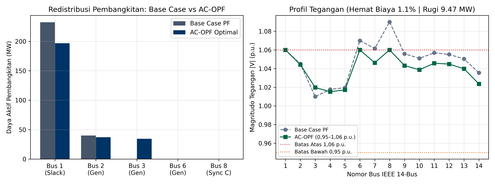
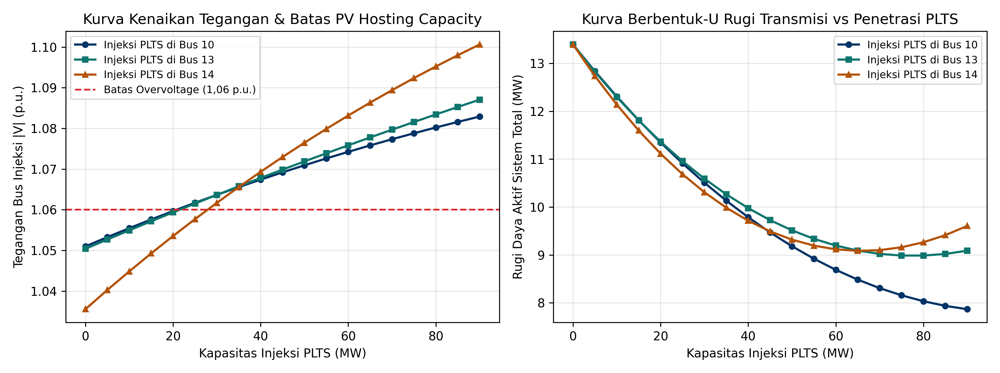
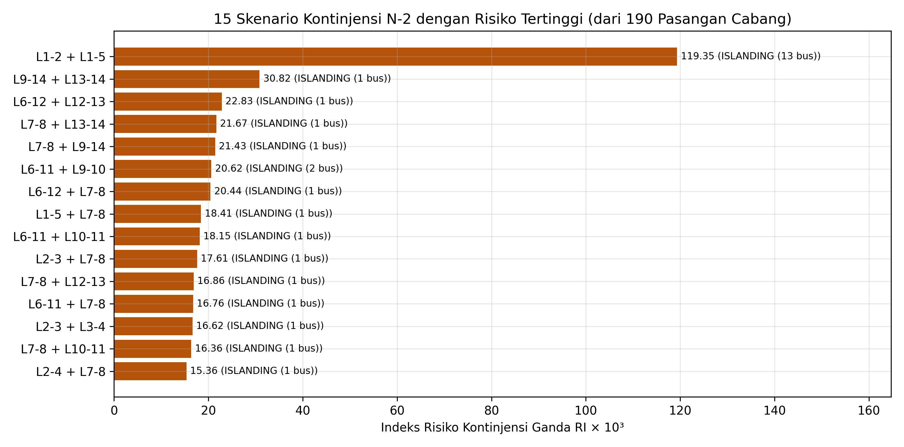

# Seri Lanjutan Level 2: Komputasi Sistem Tenaga Lanjut Menggunakan Python
## Optimal Power Flow (AC-OPF), PV Hosting Capacity & Risk-Based N-k Contingency Screening

**Silabus & Panduan Praktikum Seri Lanjutan — Edisi 1.0 (November 2026)**
**Durasi:** 3 Hari × 8 JP = 24 Jam Pelatihan  |  **Prasyarat:** Lulus Level 1 (Modul 1–4)

---

## 1. Gambaran Umum & Struktur 3 Hari

Seri Lanjutan **Level 2** dirancang untuk memperluas penguasaan aliran daya dari evaluasi deterministik kondisi tunggal menuju optimasi operasi ekonomis, integrasi energi baru terbarukan (PLTS/EBT), dan penilaian keamanan kontinjensi ganda ($N-k$) berbasis risiko. Seluruh eksperimen pada silabus ini dapat direproduksi langsung menggunakan skrip referensi [level2_advanced_studies.py](level2_advanced_studies.py).

| Hari | Modul | Fokus Utama | Luaran Terukur |
| :--- | :--- | :--- | :--- |
| **Hari 1 (8 JP)** | **Modul L2-1:** Optimal Power Flow (AC-OPF & LMP) | Fungsi biaya kuadratik, kendala tegangan/termal, harga marjinal lokasional (*LMP*) | Solusi AC-OPF, kurva penghematan biaya & peta LMP |
| **Hari 2 (8 JP)** | **Modul L2-2:** Studi *PV Hosting Capacity* & Profil Harian | Injeksi bertahap `sgen`, kurva kenaikan tegangan, efek-U rugi daya, batas *overvoltage* | Kurva kapasitas hosting PLTS per bus & rekomendasi mitigasi |
| **Hari 3 (8 JP)** | **Modul L2-3:** Skrining Kontinjensi $N-k$ Berbasis Risiko | Model probabilitas gangguan independen, penalti *islanding*, peringkat $RI_k$ pada 190 pasangan $N-2$ | Tabel [n2_risk_ranking.csv](hasil/n2_risk_ranking.csv) & grafik Top-15 Risiko |

---

## 2. Modul L2-1 — Optimal Power Flow (AC-OPF) & Locational Marginal Pricing

### (a) Tujuan Pembelajaran (Bloom C3–C6)
- **[C3]** Merumuskan masalah AC-OPF beserta fungsi objektif biaya pembangkitan kuadratik $C_g(P_g) = c_{2,g}P_g^2 + c_{1,g}P_g + c_{0,g}$ pada `pandapower`.
- **[C4]** Menganalisis selisih pengiriman daya (*dispatch*), profil tegangan, dan rugi daya antara *Base Case PF* dan *AC-OPF*.
- **[C5]** Menginterpretasikan pengali Lagrange keseimbangan daya aktif ($\lambda_{P,i}$ atau *LMP*) sebagai sinyal kemacetan transmisi (*congestion*) dan rugi marjinal.

### (b) Persamaan Inti
$$\min_{\mathbf{P}_G,\mathbf{Q}_G,|\mathbf{V}|,\boldsymbol{\theta}} \sum_{g \in \mathcal{G}} \left(c_{2,g} P_g^2 + c_{1,g} P_g + c_{0,g}\right)$$
terhadap kendala kesetimbangan aliran daya AC non-linier, batas kapabilitas pembangkit ($P_g^{\min} \le P_g \le P_g^{\max}$, $Q_g^{\min} \le Q_g \le Q_g^{\max}$), koridor tegangan ($0{,}95 \le |V_i| \le 1{,}06\text{ p.u.}$), dan batas termal cabang ($\text{loading}_l \le 100\%$).

### (c) Titik Periksa Terverifikasi (`run_ac_opf_study()` pada IEEE 14-Bus)
| Metrik | Base Case PF | AC-OPF Optimal | Perubahan |
| :--- | :---: | :---: | :---: |
| Biaya Operasi Total (`$/jam`) | `8.170,15` | **`8.082,26`** | **−1,08%** |
| Rugi Daya Aktif Total (`MW`) | `13,393` | **`9,466`** | **−29,32%** |
| Dispatch Bus 1 / 2 / 3 / 6 (`MW`) | `232,39 / 40,00 / 0 / 0` | **`196,70 / 37,14 / 34,49 / 0,13`** | Redistribusi lokal |
| Rentang LMP (`$/MWh`) | — | **`36,92 – 41,52`** | Gradien rugi marjinal |

---

## 3. Modul L2-2 — Studi *PV Hosting Capacity* & Integrasi Energi Terbarukan

### (a) Tujuan Pembelajaran (Bloom C3–C6)
- **[C3]** Membangun sapuan injeksi pembangkit statis (`pp.create_sgen`) pada bus beban untuk mengevaluasi kapasitas serap PLTS (*hosting capacity*).
- **[C4]** Menganalisis kurva berbentuk-U antara penetrasi PLTS terhadap total rugi transmisi sistem.
- **[C6]** Merancang skema kendali *Volt-VAR* (`q_mvar` penyerapan reaktif) untuk meningkatkan *hosting capacity* di atas batas faktor daya satu ($\cos\varphi = 1$).

### (b) Titik Periksa Terverifikasi (`run_pv_hosting_capacity()` pada IEEE 14-Bus)
Pemantauan batas atas tegangan area beban subsistem (Bus 9–14, batas $\le 1{,}06\text{ p.u.}$) dan batas termal $\le 100\%$:

| Bus Injeksi PLTS | Tegangan Awal (`p.u.`) | Kapasitas Hosting Aman (`MW`) | Faktor Pembatas Utama |
| :---: | :---: | :---: | :--- |
| **Bus 10** | `1,0510` | **`10,0 MW`** | *Overvoltage* ($> 1{,}06$ p.u. di area Bus 10–11) |
| **Bus 13** | `1,0504` | **`20,0 MW`** | *Overvoltage* ($> 1{,}06$ p.u.) |
| **Bus 14** | `1,0355` | **`25,0 MW`** | *Overvoltage* ($> 1{,}06$ p.u.) — margin tegangan awal tertinggi |

---

## 4. Modul L2-3 — Skrining Kontinjensi Ganda ($N-2$) Berbasis Risiko

### (a) Tujuan Pembelajaran (Bloom C4–C6)
- **[C4]** Menghitung ledakan kombinatorial kontinjensi ganda ($\binom{N_l}{2} = 190$ pasangan untuk 20 cabang IEEE 14-Bus) serta mendeteksi *islanding* multi-bus dan divergensi.
- **[C5]** Mengevaluasi perbedaan peringkat deterministik ($PI$) dibanding peringkat berbasis risiko ($RI_{ij} = p_i p_j \cdot PI_{ij}$).
- **[C6]** Mengembangkan strategi pra-penyaringan (*screening*) untuk skenario $N-k$ berskala besar (termasuk integrasi metode metaheuristik seperti *Modified Salp Swarm Algorithm / MSSA* sebagai bahan riset lanjutan).

### (b) Formulasi Indeks Risiko Kontinjensi Ganda
$$RI_{ij} = \underbrace{(p_i \cdot p_j)}_{p_{ij}} \cdot \left(PI_{S,ij} + PI_{V,ij} + P_{\text{island},ij}\right)$$
di mana $p_i \in [0{,}0025;\; 0{,}0110]$ merupakan probabilitas gangguan saluran proporsional panjang/reaktansi dan $P_{\text{island}} = 250 \cdot N_{\text{bus,terisolasi}}$ memberi bobot keparahan kehilangan pasokan.

### (c) Titik Periksa Terverifikasi (`run_n2_risk_screening()` — 190 Pasangan)
- **Total Skenario Dievaluasi:** 190 kombinasi pasangan cabang (`0` divergen, **`27` skenario memicu *islanding***).
- **3 Skenario Risiko Tertinggi:**
  1. **`L1-2 + L1-5`** (`ISLANDING 13 bus`, $RI \times 10^3 = \mathbf{119{,}35}$) — memutus Slack Bus 1 dari keseluruhan jaringan.
  2. **`L9-14 + L13-14`** (`ISLANDING 1 bus` [Bus 14], $p = 11{,}96 \times 10^{-5}$, $RI \times 10^3 = \mathbf{30{,}82}$).
  3. **`L6-12 + L12-13`** (`ISLANDING 1 bus` [Bus 12], $p = 8{,}89 \times 10^{-5}$, $RI \times 10^3 = \mathbf{22{,}83}$).
- **Kombinasi *Islanding* + *Overload* Termal Ekstrem:** `L2-3 + L7-8` (`265,64%` loading, 4 cabang *overload*, Bus 8 terisolasi).

---

## 5. Rubrik Evaluasi Seri Lanjutan Level 2

| Komponen | Bobot | Indikator Sangat Baik (Skor 4) |
| :--- | :---: | :--- |
| Implementasi & Analisis AC-OPF (L2-1) | 30% | Kendala fisik akurat, penghematan biaya & peta LMP dijelaskan secara matematis dan operasional. |
| Studi *PV Hosting Capacity* & Mitigasi (L2-2) | 35% | Sapuan otomatis multi-bus berjalan bersih, kurva rugi-U dan strategi *Volt-VAR* teruji kuantitatif. |
| Skrining Risiko $N-2$ & Reproducibility (L2-3) | 35% | Seluruh 190 pasangan selesai bebas kebocoran state, *islanding* terdeteksi, CSV & grafik siap publikasi. |
